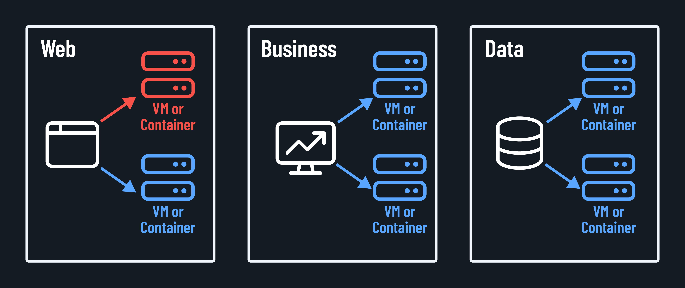

<h1>
  Why DR and HA Matter to a Business
  Implementing DR and HA
</h1>

**Learning objective:** By the end of this lesson, students will be able to discuss the key benefits a business gains from implementing DR and HA plans, and the common challenges and considerations involved in their implementation.

## Deploying DR and HA in the workplace

Let's discuss the realities of implementing DR and HA in our organizations. What are the benefits we can expect? What challenges might we face along the way?

## Benefits

First, the good news. Implementing robust DR and HA strategies can bring a host of benefits to your organization:

- **Improved reliability:** With HA measures in place, your systems can keep running even when components fail. This means less downtime, fewer interruptions, and a smoother user experience.

  Take the scenario shown in the image below. We've lost a server in our web cluster. The load balancer we implemented as part of a HA plan will automatically redirect traffic to the remaining servers. This ensures that users can still access the service without any noticeable downtime.

  

- **Faster recovery**: A well-crafted DR plan lets you to get your systems back up and running quickly after an incident. This minimizes the impact of outages and helps you resume normal operations faster.

- **Enhanced security**: Many DR and HA solutions include security features like data encryption and access controls. This can help protect your sensitive data from breaches and unauthorized access.

- **Increased customer confidence**: When your systems are reliable and always available, it builds trust with your customers. They know they can count on you to be there when needed.

- **Competitive advantage**: Providing uninterrupted service can set you apart from the competition. Investing in DR and HA can help your organization stand out in a crowded market.

## Challenges

Now, let's talk about the challenges. Implementing DR and HA is not simple. Here are some of the hurdles you might encounter:

- **Cost**: Implementing DR and HA solutions can require significant upfront investments in hardware, software, and expertise. Budgeting for these costs can be a challenge, especially for smaller organizations.

- **Complexity**: DR and HA architectures can be complex, with many moving parts to manage. This complexity can make implementation and ongoing maintenance more difficult. Some software considerations may need to be taken into account, such as licensing and support.

- **Testing and maintenance**: For DR and HA to be effective, they must be regularly tested and updated. This requires ongoing time and resources, which can strain IT teams.

- **Skill requirements**: Implementing and managing DR and HA often requires specialized skills and knowledge. Finding and retaining staff with these skills can be a challenge.

- **Balancing priorities**: In the face of competing priorities and limited resources, it can be tempting to put DR and HA on the back burner. Overcoming this inertia and prioritizing DR and HA can be challenging.

Despite these challenges, the benefits of DR and HA far outweigh the costs. By investing in these critical safeguards, you're investing in your organization's the resilience and long-term success.

## So, where do you start?

Assuming you're not starting from the ground up, the first step is to assess your current DR and HA capabilities and identify areas for improvement.

From there, you can develop a roadmap for implementation that aligns with your business goals and resources.

Remember, DR and HA are not one-time projects but ongoing processes. By making them a regular part of your IT operations, you can ensure that your organization is always ready to face whatever challenges come your way.

The road ahead may be challenging, but the destination - a resilient, always-on digital enterprise - is worth the journey.
