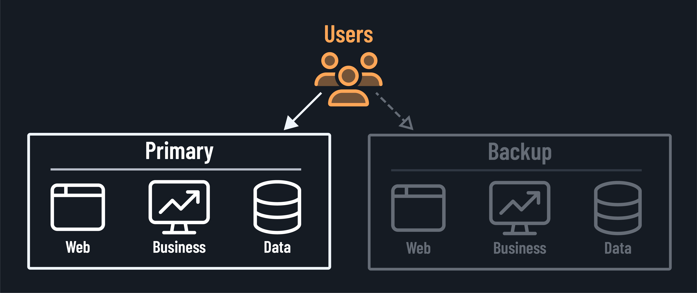
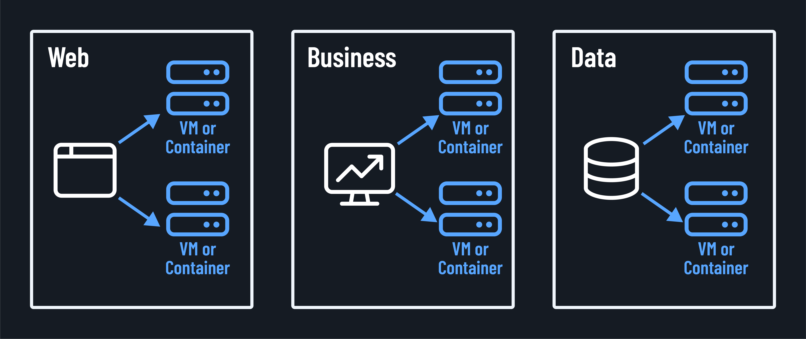

<h1>
  Why DR and HA Matter to a Business
  What are Disaster Recovery (DR) and High Availability (HA)?
</h1>

**Learning objective:** By the end of this lesson, students will be able to define Disaster Recovery and High Availability, differentiate between the two concepts, and explain their respective roles in ensuring business continuity.

## Anticipating the unexpected

At their core, disaster recovery and high availability are all about expecting the unexpected and being prepared. Just like in life, things don't always go according to plan in the world of IT. Hardware fails, software has bugs, natural disasters strike, and human errors happen. DR and HA are the trusty sidekicks that help us handle these bumps in the road.

So what exactly are they? Let's break it down:

### Disaster recovery (DR)

Disaster recovery is our trusty plan B. It's the set of policies, tools, and procedures that allow us to recover our technology infrastructure and systems after an unexpected event. Think of DR as our parachute - we hope we never have to use it, but we're sure glad we have it if needed!

As you can see in the image above, DR often involves keeping a duplicate instance of our systems in a different location, so that if something goes wrong at our primary site, we can quickly switch over to the backup.

Some key aspects of a solid DR plan include:

- Regular data backups.
- Detailed recovery procedures.
- Periodic testing to ensure everything works as intended.

### High availability (HA)

Highly available systems should always be up and running, even in the face of failures. HA involves designing redundancy and failover into our architecture so that if one component goes down, another can seamlessly take its place without disrupting service.

While DR focuses on recovering from major incidents, HA aims to prevent those incidents from becoming outages in the first place. They work hand-in-hand to keep our digital ship afloat.

For HA, we implement strategies like:

- Clustering.
- Load balancing.
- Multi-zone deployments.

## Differentiating DR and HA

While DR and HA are often implemented together, they serve different purposes in the realm of IT:

- **Scope**: HA focuses on individual component failures or small-scale disruptions, while DR addresses larger, more widespread disasters affecting entire systems or locations.

- **Goal**: HA aims to prevent downtime altogether or make it so short as to be unnoticeable, while DR focuses on minimizing the duration of downtime after a disaster.

- **Timeframe**: HA is about immediate failover (seconds or minutes), while DR involves a recovery process that might take some time (hours or days), depending on the severity of the disaster and the complexity of the systems.

- **Cost**: HA solutions tend to be more expensive due to the need for redundancy and real-time synchronization, while DR solutions can be more cost-effective depending on the RTO and RPO requirements.

The goal is to make our systems resilient and recoverable so that when *Murphy's law* inevitably strikes, we're ready to spring into action and keep the lights on for our users. No matter the size of your organization, having DR and HA strategies is crucial.

> 📚 Murphy's law, named after aerospace engineer Edward Murphy, states that "Anything that can go wrong will go wrong.".
